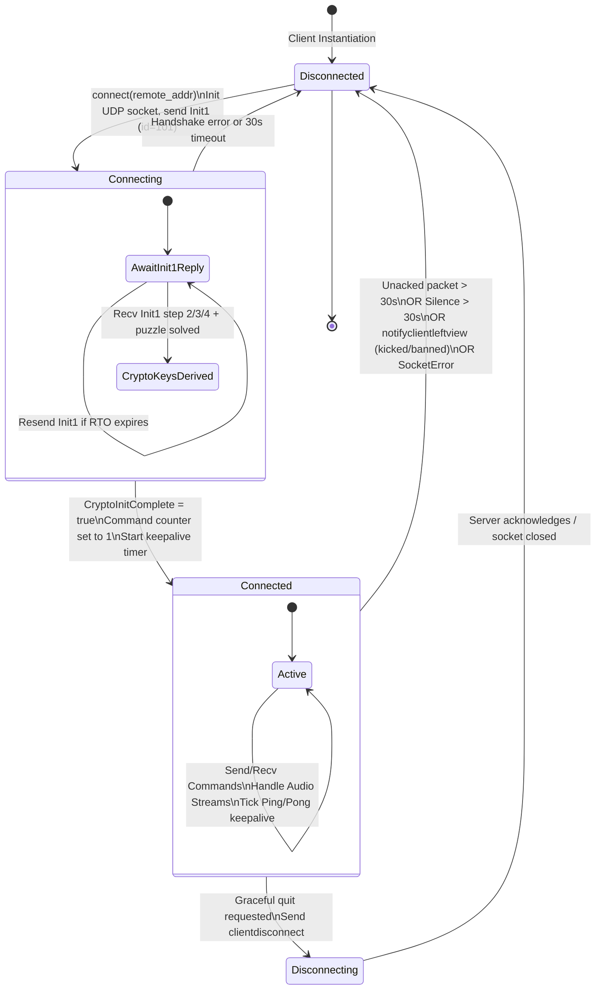

# TeamSpeak 3 Protocol Specification: Transport & Reliability Layer (UDP)

## 1. Overview & Architectural Scope

The TeamSpeak 3 transport layer runs directly over UDP. It provides a multiplexed, multi-channel transport protocol supporting:
- Unreliable, low-latency streaming for audio data (`Voice`, `VoiceWhisper`).
- Reliable, in-order, acknowledged streaming for control transactions (`Command`, `CommandLow`).
- Connection setup and cryptographic exchange (`Init1`).
- Connection health monitoring, keepalive, and RTT sampling (`Ping`, `Pong`).

Every UDP datagram carries an authenticated header, independent 16-bit packet sequence numbers partitioned across 9 packet types, and optional QuickLZ level-1 compression and message fragmentation.

---

## 2. UDP Datagram Layout & Wire Headers

### 2.1 Packet Layout Comparison: Client-to-Server (C->S) vs Server-to-Client (S->C)

The UDP datagram consists of a fixed transport header followed by the packet payload. 
- The Client-to-Server (**C->S**) header is **13 bytes** (`Packet.cs:186`: `C2S.HeaderLen = 5`, plus 8 bytes MAC = 13).
- The Server-to-Client (**S->C**) header is **11 bytes** (`Packet.cs:193`: `S2C.HeaderLen = 3`, plus 8 bytes MAC = 11).

The 2-byte difference is the `client_id` field: the client must include its server-assigned Client ID on every outgoing datagram so the server can demultiplex incoming UDP datagrams across multiple clients sharing the same server port. In S->C datagrams, `client_id` is omitted because the client socket receives datagrams directly from the server endpoint (`Packet.cs:20-22, 184-195`).

```
Client-to-Server (C->S) Header Layout (13 bytes):
+-------------------------------+-------------------+-------------------+--------------------+------------------------+
| 0                           7 | 8               9 | 10             11 | 12                 | 13                 ... |
+-------------------------------+-------------------+-------------------+--------------------+------------------------+
|           MAC (8 B)           |   Packet ID (u16) |  Client ID (u16)  | Type / Flags (u8)  | Payload Data (0..487B) |
|           [bytes 0..7]        |     Big-Endian    |    Big-Endian     | [flags:4 | type:4] |                        |
+-------------------------------+-------------------+-------------------+--------------------+------------------------+

Server-to-Client (S->C) Header Layout (11 bytes):
+-------------------------------+-------------------+--------------------+------------------------+
| 0                           7 | 8               9 | 10                 | 11                 ... |
+-------------------------------+-------------------+--------------------+------------------------+
|           MAC (8 B)           |   Packet ID (u16) | Type / Flags (u8)  | Payload Data (0..489B) |
|           [bytes 0..7]        |     Big-Endian    | [flags:4 | type:4] |                        |
+-------------------------------+-------------------+--------------------+------------------------+
```

### 2.2 Wire Header Fields and Offsets

| Field | Offset (C->S) | Offset (S->C) | Size | Endianness | Verification | Description |
|---|---|---|---|---|---|---|
| `mac` | `0..8` | `0..8` | 8 bytes | Opaque | `TsCrypt.cs:40, 44, 528, 565`, `Packet.cs:149, 155` | AEAD EAX MAC tag if encrypted; static constant if unencrypted or handshake. |
| `packet_id` | `8..10` | `8..10` | 2 bytes | Big-Endian (`u16`) | `Packet.cs:124, 130, 149, 155` | Monotonically increasing sequence number per packet type (0..65535). |
| `client_id` | `10..12` | *N/A* | 2 bytes | Big-Endian (`u16`) | `Packet.cs:131, 156, 186` | Server-assigned Client ID. Sent as `0x0000` before assignment. |
| `type_flags` | `12` | `10` | 1 byte | Byte | `Packet.cs:25-33, 125, 132, 150, 157` | Upper 4 bits: `PacketFlags`; Lower 4 bits: `PacketType`. |
| `payload` | `13..` | `11..` | Variable | Byte stream | `Packet.cs:85`, `TsCrypt.cs:569, 581` | Packet data payload (plaintext or encrypted ciphertext). |

### 2.3 Sizing and Content Limits

| Parameter | Value | Reference | Calculation / Notes |
|---|---|---|---|
| `MaxOutPacketSize` | **500 bytes** | `PacketHandlerConst.MaxOutPacketSize` (`PacketHandler.cs:797`) | Hard limit on the entire UDP datagram length. |
| C->S Header Size | 13 bytes | `PacketHandler.cs:25`, `Packet.cs:186` | MAC (8) + Header (5) |
| S->C Header Size | 11 bytes | `Packet.cs:21, 193` | MAC (8) + Header (3) |
| C->S `MaxOutContentSize` | **487 bytes** | `PacketHandler.cs:26` | `MaxOutPacketSize (500) - 13 = 487` bytes. |
| S->C `MaxOutContentSize` | **489 bytes** | Inferred from `Packet.cs:193` | `MaxOutPacketSize (500) - 11 = 489` bytes. |
| `MaxDecompressedSize` | 1,048,576 bytes | `PacketHandlerConst.MaxDecompressedSize` (`PacketHandler.cs:798`) | Safety cap on decompressed command payload (server default: 40,000 bytes). |

---

## 3. Packet Types, Flags, and Payload Formats

### 3.1 Packet Types (`PacketType`, Low 4 Bits)

The low 4 bits of the `type_flags` byte (`type_flags & 0x0F`) encode the packet type (`PacketType.cs:14-25`):

| Enum Identifier | Value (Hex) | Value (Dec) | Direction | Description | Source |
|---|---|---|---|---|---|
| `Voice` | `0x0` | 0 | Bidirectional | Audio stream data. Unreliable, unencrypted. | `PacketType.cs:16` |
| `VoiceWhisper` | `0x1` | 1 | Bidirectional | Targeted whisper audio stream. Unreliable. | `PacketType.cs:17` |
| `Command` | `0x2` | 2 | Bidirectional | Reliable control commands/notifications. | `PacketType.cs:18` |
| `CommandLow` | `0x3` | 3 | Bidirectional | Low-priority reliable commands. | `PacketType.cs:19` |
| `Ping` | `0x4` | 4 | Bidirectional | Heartbeat probe sent to measure RTT and loss. | `PacketType.cs:20` |
| `Pong` | `0x5` | 5 | Bidirectional | Heartbeat reply acknowledging a Ping probe. | `PacketType.cs:21` |
| `Ack` | `0x6` | 6 | Bidirectional | Acknowledgement for `Command` packets. | `PacketType.cs:22` |
| `AckLow` | `0x7` | 7 | Bidirectional | Acknowledgement for `CommandLow` packets. | `PacketType.cs:23` |
| `Init1` | `0x8` | 8 | Bidirectional | Cryptographic negotiation handshake packet. | `PacketType.cs:24` |

Values `0x9` through `0xF` are invalid and treated as protocol errors.

### 3.2 Packet Flags (`PacketFlags`, High 4 Bits)

The high 4 bits of the `type_flags` byte (`type_flags & 0xF0`) encode transport flags (`PacketType.cs:28-35`):

| Flag Identifier | Bit Mask | Bit Index | Semantic Meaning | Source |
|---|---|---|---|---|
| `None` | `0x00` | - | No flags asserted. | `PacketType.cs:30` |
| `Fragmented` | `0x10` | Bit 4 | Set on the **first** and **last** fragment of a segmented message. **Clear on all middle fragments.** | `PacketType.cs:31`, `PacketHandler.cs:233-234` |
| `Newprotocol` | `0x20` | Bit 5 | Indicates modern protocol dialect (mandatory on `Command`/`CommandLow`; modern whisper framing). | `PacketType.cs:32`, `PacketHandler.cs:278`, `TsFullClient.cs:643` |
| `Compressed` | `0x40` | Bit 6 | Payload is compressed with QuickLZ level-1. Present on the first fragment if split. | `PacketType.cs:33`, `PacketHandler.cs:206` |
| `Unencrypted` | `0x80` | Bit 7 | Datagram payload is not encrypted with AES-EAX (authenticated by fake signature MAC). | `PacketType.cs:34`, `PacketHandler.cs:271, 286, 291, 300, 305` |

### 3.3 Default Flags and MAC Modes by Packet Type

When building packets, default flags and MAC authentication modes are assigned according to type (`PacketHandler.cs:267-312`, `TsCrypt.cs:524-539`):

| Packet Type | Default Flags | Wire Flags Byte | Encryption / MAC Mode | Source |
|---|---|---|---|---|
| `Voice` (`0x0`) | `Unencrypted` | `0x80` | `fakeSignature` MAC (`TsCrypt.cs:533`) | `PacketHandler.cs:271` |
| `VoiceWhisper` (`0x1`) | `Unencrypted [\| Newprotocol]` | `0x80` or `0xA0` | `fakeSignature` MAC (`TsCrypt.cs:533`) | `PacketHandler.cs:271`, `TsFullClient.cs:643` |
| `Command` (`0x2`) | `Newprotocol [\| Cmp] [\| Frag]` | `0x20` (or `0x30/60/70`) | AES-128-EAX Encrypted (`TsCrypt.cs:537-539`) | `PacketHandler.cs:278` |
| `CommandLow` (`0x3`) | `Newprotocol [\| Cmp] [\| Frag]` | `0x20` (or `0x30/60/70`) | AES-128-EAX Encrypted (`TsCrypt.cs:537-539`) | `PacketHandler.cs:278` |
| `Ping` (`0x4`) | `Unencrypted` | `0x84` | `fakeSignature` MAC (`TsCrypt.cs:533`) | `PacketHandler.cs:286` |
| `Pong` (`0x5`) | `Unencrypted` | `0x85` | `fakeSignature` MAC (`TsCrypt.cs:533`) | `PacketHandler.cs:291` |
| `Ack` (`0x6`) | `None` (Encrypted) | `0x06` | AES-128-EAX Encrypted (`TsCrypt.cs:537-539`) | `PacketHandler.cs:295` |
| `AckLow` (`0x7`) | `Unencrypted` | `0x87` | `fakeSignature` MAC (`TsCrypt.cs:533`) | `PacketHandler.cs:300` |
| `Init1` (`0x8`) | `Unencrypted` | `0x88` | Constant ASCII `TS3INIT1` (`TsCrypt.cs:40, 528`) | `PacketHandler.cs:305` |

### 3.4 MAC Modes Detail

The 8-byte `mac` header field operates in one of three distinct modes (`TsCrypt.cs:524-539, 573-583`):

1. **`Init1` Handshake Mode (`PacketType == 0x8`):**
   - MAC value is the constant 8-byte ASCII string: `b"TS3INIT1"` (`[0x54, 0x53, 0x33, 0x49, 0x4E, 0x49, 0x54, 0x31]`).
   - Source: `TsCrypt.cs:40, 528, 588`.

2. **`Unencrypted` Mode (`PacketFlags::Unencrypted (0x80)` set):**
   - Before handshake step 2 completes: 8 zero bytes `[0u8; 8]` (`TsCrypt.cs:52`).
   - After handshake step 2 completes: The 8-byte `fakeSignature` derived from `SHA1(ivStruct)[0..8]` (`TsCrypt.cs:303-305, 533, 591`).

3. **AES-128-EAX Encrypted Mode (`Unencrypted` flag NOT set):**
   - The 8-byte truncated MAC tag generated by AES-128-EAX authenticated encryption over the transport header (as AAD) and payload data (`TsCrypt.cs:539, 565-570`).

### 3.5 Payload Formats by Packet Type

#### 3.5.1 Voice (`0x0`) & VoiceWhisper (`0x1`)
Voice packets prefix codec data with a 2-byte Voice Packet ID in the first two payload bytes (`PacketHandler.cs:272`):
```
Standard Voice Payload:
+-------------------+-------------------+-------------+------------------------------+
| 0               1 | 2               3 | 4           | 5                        ... |
+-------------------+-------------------+-------------+------------------------------+
|  Voice Packet ID  |  Sender Client ID |  Codec ID   |      Encoded Audio Data      |
|     (u16 BE)      |     (u16 BE)      |    (u8)     |     (e.g., Opus frames)      |
+-------------------+-------------------+-------------+------------------------------+
```
- `Voice Packet ID`: Written to `data[0..2]` matching `packet.PacketId` (`PacketHandler.cs:272`).
- `Sender Client ID`: Written to `data[2..4]` (`AudioPacketReader.cs:33`).
- `Codec ID`: 1 byte (`AudioPacketReader.cs:34`). Values: Opus Voice (`0x4`), Opus Music (`0x5`), Speex/CELT (legacy).
- `VoiceWhisper` targeting metadata (when `Newprotocol` is set): Codec (`data[2]`), Type (`data[3]`), Target (`data[4]`), Target ID (`data[5..13]`, `u64` BE), followed by audio data (`TsFullClient.cs:636-641`).

#### 3.5.2 Ping (`0x4`) & Pong (`0x5`)
- **Ping (`0x4`):** Data length is **0 bytes** (`PacketHandler.cs:582`). The datagram header `packet_id` identifies the ping sequence number.
- **Pong (`0x5`):** Data length is **2 bytes** (`PacketHandler.cs:592-594`). Contains the `packet_id` of the `Ping` packet being acknowledged in Big-Endian `u16`:
```
Pong Payload Layout (2 bytes):
+-----------------------------------+
| 0                               1 |
+-----------------------------------+
| Ping Packet ID to Ack (u16 BE)    |
+-----------------------------------+
```

#### 3.5.3 Ack (`0x6`) & AckLow (`0x7`)
- Data length is **2 bytes** (`PacketHandler.cs:557-558`).
- Contains the `packet_id` of the acknowledged `Command` or `CommandLow` packet in Big-Endian `u16`:
```
Ack / AckLow Payload Layout (2 bytes):
+-----------------------------------+
| 0                               1 |
+-----------------------------------+
| Acknowledged Packet ID (u16 BE)   |
+-----------------------------------+
```

#### 3.5.4 Command (`0x2`) & CommandLow (`0x3`)
Plaintext command string formatted in TeamSpeak query syntax (e.g., `clientinit ...\n\0`). May be compressed with QuickLZ level-1 and/or fragmented across multiple packets.

---

## 4. Per-Type Packet ID Counters & Generation Wraparound

### 4.1 Independent Counters

TeamSpeak 3 maintains independent sequence counters for each of the 9 packet types (`PacketHandler.cs:79-80`, `TsCrypt.cs:45`):
- `PacketTypeKinds = 9` (indices `0..8` corresponding to `PacketType` values).
- State:
  - `packetCounter: [u16; 9]`
  - `generationCounter: [u32; 9]`

```rust
fn inc_packet_counter(&mut self, packet_type: PacketType) {
    let idx = packet_type as usize;
    self.packet_counter[idx] = self.packet_counter[idx].wrapping_add(1);
    if self.packet_counter[idx] == 0 {
        self.generation_counter[idx] = self.generation_counter[idx].wrapping_add(1);
    }
}
```
*Source: `PacketHandler.cs:324-329`.*

### 4.2 Special Sequence Initialization Rules

1. **`Init1` Fixed Packet ID:**
   - Outgoing `Init1` packets do **not** consume from `packetCounter[Init1]`.
   - The packet ID is hardcoded to **`101` (`0x0065`)**, and generation is **`0`** (`PacketHandler.cs:320-322`).
2. **Command Sequence Start & Phantom `clientinitiv`:**
   - Legacy TS3 clients sent a `clientinitiv` command as packet ID 0 before sending handshake packets.
   - Modern clients skip transmitting `clientinitiv` over the wire, but **must pre-increment the `Command` counter from 0 to 1 upon `Connect()`** (`PacketHandler.cs:89-94`).
   - Consequently, the first real `Command` packet sent by the client always carries **`packet_id = 1`** and **`generation = 0`**.

### 4.3 Generation Tracking & Cryptographic Nonce Derivation

The 32-bit `generation` number is never sent over the wire; receivers track it via sliding window math. Generation and packet ID are combined with `ivStruct` to derive per-packet AES-128 keys and nonces (`TsCrypt.cs:656-700`):

1. Direction byte: `0x30` for Server-to-Client (S2C), `0x31` for Client-to-Server (C2S) (`TsCrypt.cs:678`).
2. Construct hashing buffer: `[direction (1B), packetType (1B), generation (4B BE), ivStruct (20B or 64B)]` (`TsCrypt.cs:676-682`).
3. Compute `H = SHA256(buffer)`.
4. Derive base key and base nonce:
   - `base_key = H[0..16]`
   - `base_nonce = H[16..32]`
   - Cache tuple `(base_key, base_nonce)` per `(direction, packetType, generation)` (`TsCrypt.cs:670-688`).
5. Per-packet XOR modification:
   - `key = base_key.clone()`
   - `key[0] ^= (packet_id >> 8) as u8`
   - `key[1] ^= (packet_id & 0xFF) as u8`
   - `nonce = base_nonce` (nonce remains unmodified by `packet_id`) (`TsCrypt.cs:695-697`).

### 4.4 Generation Window Algorithm (`GenerationWindow.cs`)

The `GenerationWindow` tracks a window of size $W$ within a modular ring of size $M = 65536$ ($2^{16}$) (`GenerationWindow.cs:14-105`):

- Modulo: $M = 65536$ (`ushort.MaxValue + 1`)
- Command Window Size: $W = 128$ (`PacketHandlerConst.ReceivePacketWindowSize = 128`)
- Voice Window Size: $W = 32768$ ($M / 2$) (`GenerationWindow.cs:21`)

#### Mathematical Definitions:
- `mapped_base_offset`: `i32` ($0 \le \text{offset} < M$)
- `generation`: `u32`

1. **In-Window Check (`IsInWindow(p)`):**
   $$\text{max\_offset} = \text{mapped\_base\_offset} + W$$
   $$\text{in\_window} = \begin{cases}
   p \ge \text{base} \land p < \text{max\_offset}, & \text{if } \text{max\_offset} < M \\
   p \ge \text{base} \lor p < (\text{max\_offset} - M), & \text{if } \text{max\_offset} \ge M
   \end{cases}$$
   *Source: `GenerationWindow.cs:62-73`.*

2. **Next-Generation Rollover Check (`IsNextGen(p)`):**
   Detects whether packet $p$ belongs to generation $G + 1$ when the window spans the $65535 \to 0$ boundary before the base offset has rolled over:
   $$\text{is\_next\_gen} = \left(\text{mapped\_base\_offset} > M - W\right) \land \left(p < (\text{mapped\_base\_offset} + W) - M\right)$$
   *Source: `GenerationWindow.cs:75-77`.*

3. **Generation Resolution (`GetGeneration(p)`):**
   $$G(p) = \text{generation} + \begin{cases} 1, & \text{if } \text{IsNextGen}(p) \\ 0, & \text{otherwise} \end{cases}$$
   *Source: `GenerationWindow.cs:79`.*

4. **Index Mapping (`MappedToIndex(p)`):**
   $$\text{index} = \begin{cases}
   (p + M) - \text{mapped\_base\_offset}, & \text{if } \text{IsNextGen}(p) \\
   p - \text{mapped\_base\_offset}, & \text{otherwise}
   \end{cases}$$
   *Source: `GenerationWindow.cs:81-98`.*

5. **Window Dragging for Lossy Streams (`AdvanceToExcluded(p)`):**
   Used for `Voice` and `VoiceWhisper` streams where gaps are dropped rather than retransmitted:
   $$\text{move\_dist} = (p - \text{mapped\_base\_offset}) + 1$$
   $$\text{if } \text{move\_dist} > 0 \implies \text{Advance}(\text{move\_dist})$$
   Advancing by $D$:
   $$\text{new\_offset} = \text{mapped\_base\_offset} + D$$
   $$\text{generation} \mathrel{+}= \lfloor \text{new\_offset} / M \rfloor$$
   $$\text{mapped\_base\_offset} = \text{new\_offset} \pmod M$$
   *Source: `GenerationWindow.cs:37-60`.*

### 4.5 Command Reordering Ring Queue (`RingQueue.cs`)

For reliable commands (`Command` and `CommandLow`), packets may arrive out of order. A `RingQueue` structure of capacity $W = 128$ buffers out-of-order packets (`RingQueue.cs:29, 114-123`):

#### Slot Statuses (`ItemSetStatus`):
- `OutOfWindowNotSet` ($0$): Discarded (too far ahead of window or stale).
- `OutOfWindowSet` ($1$): Stale packet already processed.
- `InWindowNotSet` ($2$): Empty slot within window, waiting for arrival.
- `InWindowSet` ($3$): Populated slot within window, awaiting sequential draining.

#### Receipt & Processing Steps (`PacketHandler.cs:462-481`):
1. On arrival of packet $p$, evaluate `status = ring_queue.is_set(p)`.
2. If `status == OutOfWindowNotSet`, drop datagram immediately (`PacketHandler.cs:467-468`).
3. Send `Ack` (or `AckLow`) immediately with payload $p$ regardless of whether the packet was previously seen (`PacketHandler.cs:470`).
4. If already set (`status.has_flag(Set)`), drop duplicate payload (`PacketHandler.cs:473-474`).
5. Place packet in slot: `ring_queue.set(p, packet)` (`PacketHandler.cs:476`).
6. Sequentially drain all contiguous ready messages from slot 0 via `TryGetCommand` (`PacketHandler.cs:477-478`).
7. For each drained packet, advance window by 1: `Window.Advance(1)` (`RingQueue.cs:129`).

---

## 5. Reliability, ACK/Resend Layer & Timers

### 5.1 Reliability Matrix by Packet Type

| Packet Type | Reliable? | Subject to Resend? | Retransmit Manager | Acknowledged By | Source |
|---|---|---|---|---|---|
| `Voice` (`0x0`) | No | No | None | None | `PacketHandler.cs:271` |
| `VoiceWhisper` (`0x1`)| No | No | None | None | `PacketHandler.cs:271` |
| `Command` (`0x2`) | **Yes** | **Yes** | `packetAckManager` | `Ack` (`0x6`) | `PacketHandler.cs:279-280, 409` |
| `CommandLow` (`0x3`)| **Yes** | **Yes** | `packetAckManager` | `AckLow` (`0x7`) | `PacketHandler.cs:279-280, 413` |
| `Ping` (`0x4`) | No | Probe loop | Managed by ping interval | `Pong` (`0x5`) | `PacketHandler.cs:284, 417` |
| `Pong` (`0x5`) | No | No | None | None | `PacketHandler.cs:290, 421` |
| `Ack` (`0x6`) | No | No | None | None | `PacketHandler.cs:295, 425` |
| `AckLow` (`0x7`) | No | No | None | None | `PacketHandler.cs:299` |
| `Init1` (`0x8`) | **Yes** | **Yes** | `initPacketCheck` | Steps through Init1 | `PacketHandler.cs:306-308, 431` |

### 5.2 Protocol Timers & Constants

| Constant Name | Value | Description | Source |
|---|---|---|---|
| `PacketTimeout` | `30.0 s` | Max time allowed for unacknowledged packet before connection loss. | `PacketHandlerConst.PacketTimeout` (`PacketHandler.cs:785`) |
| `MaxRetryInterval` | `1000 ms` | Retransmission timeout cap ($RTO_{\max}$). | `PacketHandlerConst.MaxRetryInterval` (`PacketHandler.cs:791`) |
| `ClockResolution` | `100 ms` | Tick interval of background resend loop and timer checks. | `PacketHandlerConst.ClockResolution` (`PacketHandler.cs:793`) |
| `PingInterval` | `1000 ms` | Interval between keepalive `Ping` transmissions. | `PacketHandlerConst.PingInterval` (`PacketHandler.cs:794`) |
| `AlphaSmooth` ($\alpha$) | `0.125` ($1/8$) | RFC 6298 SRTT smoothing factor. | `PacketHandlerConst.AlphaSmooth` (`PacketHandler.cs:787`) |
| `BetaSmooth` ($\beta$) | `0.250` ($1/4$) | RFC 6298 RTTVAR variation smoothing factor. | `PacketHandlerConst.BetaSmooth` (`PacketHandler.cs:789`) |

### 5.3 RFC 6298 RTO & SRTT Smoothing Algorithm

Initial connection values (`PacketHandler.cs:121-123`):
$$\text{SRTT}_0 = 1000\text{ ms}$$
$$\text{RTTVAR}_0 = 0\text{ ms}$$
$$\text{RTO}_0 = 1000\text{ ms}$$

When an ACK or Pong is received for a packet with round-trip measurement $R$:
1. If $\text{SRTT} < 0$, initialize $\text{SRTT} = R$ (`PacketHandler.cs:645-646`).
2. Otherwise update $\text{SRTT}$:
   $$\text{SRTT}_{i+1} = (1 - \alpha) \cdot \text{SRTT}_i + \alpha \cdot R$$
3. Update $\text{RTTVAR}$ using the newly computed $\text{SRTT}_{i+1}$:
   $$\text{RTTVAR}_{i+1} = (1 - \beta) \cdot \text{RTTVAR}_i + \beta \cdot | R - \text{SRTT}_{i+1} |$$
4. Compute new RTO:
   $$\text{RTO}_{i+1} = \text{SRTT}_{i+1} + \max(\text{ClockResolution}, 4 \cdot \text{RTTVAR}_{i+1})$$

```rust
fn update_rto(&mut self, sample_rtt: Duration) {
    if self.smoothed_rtt.is_zero() {
        self.smoothed_rtt = sample_rtt;
    } else {
        let srtt_secs = (1.0 - 0.125) * self.smoothed_rtt.as_secs_f64()
            + 0.125 * sample_rtt.as_secs_f64();
        self.smoothed_rtt = Duration::from_secs_f64(srtt_secs);
    }

    let diff = (sample_rtt.as_secs_f64() - self.smoothed_rtt.as_secs_f64()).abs();
    let rttvar_secs = (1.0 - 0.25) * self.smoothed_rtt_var.as_secs_f64()
        + 0.25 * diff;
    self.smoothed_rtt_var = Duration::from_secs_f64(rttvar_secs);

    let var_term = (4.0 * self.smoothed_rtt_var).max(Duration::from_millis(100));
    self.current_rto = self.smoothed_rtt + var_term;
}
```
*Source: `PacketHandler.cs:639-652`.*

### 5.4 Retransmission Loop & Exponential Backoff

Every `ClockResolution` (100 ms), the client checks pending unacknowledged packets (`PacketHandler.cs:658-743`):

1. **Total Timeout Check:**
   $$\text{if } (\text{now} - \text{entry.first\_send\_time}) \ge 30.0\text{ s} \implies \text{Disconnect (Timeout)}$$
2. **Retransmit Check:**
   $$\text{if } (\text{now} - \text{entry.last\_send\_time}) \ge \text{current\_rto}:$$
   - Double current RTO capped at `MaxRetryInterval`:
     $$\text{current\_rto} = \min(2 \times \text{current\_rto}, 1000\text{ ms})$$
   - Update timestamp: $\text{entry.last\_send\_time} = \text{now}$
   - Retransmit exact byte-identical raw packet buffer: `SendRaw(packet.raw)` (`PacketHandler.cs:734-740`).

### 5.5 Shady ACK Decryption Fallback for Packet ID <= 2

During connection setup, the client transmits two packets in immediate succession (`TsCrypt.cs:597-615`):
- `[PacketId: 1] clientek` (encrypted with fixed dummy key).
- `[PacketId: 2] clientinit` (encrypted with real session keys).

Because UDP does not preserve delivery order, the ACKs from the server may arrive out of order or before the local state flags `CryptoInitComplete = true`. 

#### The Shady ACK Algorithm (`TsCrypt.cs:593-615`):
1. When receiving an encrypted packet, attempt decryption using the active key (`dummyEncryption = !CryptoInitComplete`).
2. If decryption succeeds, return packet.
3. If decryption fails, evaluate:
   ```csharp
   if (packet.PacketType == PacketType.Ack && packet.PacketId <= 2)
   {
       // Shady ACK fallback: Retry decryption with dummy key/nonce
       return DecryptData(ref packet, dummyEncryption: true);
   }
   ```
4. **Dummy Key and Nonce Constants (`TsCrypt.cs:36-39`):**
   ```csharp
   private const string DummyKeyAndNonceString = "c:\\windows\\system\\firewall32.cpl";
   // DummyKey = first 16 ASCII bytes: b"c:\\windows\\syste"
   // DummyIv  = next 16 ASCII bytes:  b"m\\firewall32.cpl"
   ```
   If the retry succeeds, the ACK is accepted and properly cleared from `packetAckManager`.

---

## 6. Keepalive (Ping/Pong) & NetworkStats

### 6.1 Ping / Pong Protocol

```
Client                                                  Server
  |                                                       |
  | --- Ping [packet_id = N, payload = empty] ----------> |
  |                                                       | (Records N)
  | <--- Pong [payload = N (u16 BE)] -------------------- |
  |                                                       |
(Elapsed RTT calculated -> UpdateRto(elapsed))
```

1. **Trigger Condition:**
   - Evaluated in `ResendLoop()` every 100 ms (`PacketHandler.cs:684-697`).
   - Guarded by `crypto_init_complete`: Pings are only sent after cryptographic handshake completes (`PacketHandler.cs:687`).
   - If $\text{now} - \text{ping\_check} \ge 1.0\text{ s}$:
     - If gap $> 2 \times \text{PingInterval}$, reset `ping_check = now` (handles system sleep/wake); otherwise `ping_check += 1.0s` (`PacketHandler.cs:692-695`).
     - Increment `packetCounter[Ping]`, record `last_sent_ping_id`, send 0-byte Ping packet (`PacketHandler.cs:696`).
2. **Ping Receipt (Server -> Client):**
   - On receipt of `Ping` with ID $P$:
     - Check sequence gap: $\Delta = P - \text{last\_received\_ping\_id}$. If $1 < \Delta < 128$, log $\Delta - 1$ lost pings (`PacketHandler.cs:587-589`).
     - Send `Pong` packet with payload set to $P$ in Big-Endian `u16` (`PacketHandler.cs:592-594`).
3. **Pong Receipt (Client <- Server):**
   - Read $P_{\text{reply}}$ from 2-byte payload.
   - If $P_{\text{reply}} == \text{last\_sent\_ping\_id}$:
     - Measure sample RTT $R = \text{ping\_timer.elapsed}$ (`PacketHandler.cs:603`).
     - Update RTO: `UpdateRto(R)`.
     - Record $R$ into `NetworkStats.AddPing(R)` (`PacketHandler.cs:606`, `NetworkStats.cs:62-70`).

### 6.2 NetworkStats & `setconnectioninfo` Reporting

`NetworkStats` monitors traffic across three high-level packet categories (`NetworkStats.cs:72-91`):
- **Speech (`PacketKind.Speech`):** `Voice` (`0x0`), `VoiceWhisper` (`0x1`).
- **Keepalive (`PacketKind.Keepalive`):** `Ping` (`0x4`), `Pong` (`0x5`).
- **Control (`PacketKind.Control`):** `Command` (`0x2`), `CommandLow` (`0x3`), `Ack` (`0x6`), `AckLow` (`0x7`), `Init1` (`0x8`).

#### Rolling Windows & Statistical Tracking (`NetworkStats.cs:22-31, 93-145`):
- Lifetime counters: `outPackets[3]`, `inPackets[3]`, `outBytes[3]`, `inBytes[3]`.
- Rolling packet queues: `outBytesTime`, `inBytesTime` (retained for 60 seconds).
- Ping latency queue: `pingTimes` (up to 60 samples).
- 1-second and 1-minute bandwidth averages calculated on demand.
- Standard deviation of ping:
  $$\sigma = \sqrt{\frac{\sum_{i=1}^n (x_i - \bar{x})^2}{n - 1}}$$
  *Source: `NetworkStats.cs:181-194`.*

#### Server Query & Answer (`ClientConnectionInfoUpdateRequest` -> `setconnectioninfo`):
When the server sends notification `notifyclientconnectioninfoupdaterequest` (or `clientconnectioninfoupdaterequest`), the client responds with command `setconnectioninfo` containing the following 30 fields (`NetworkStats.cs:147-179`, `TsFullClient.cs:353-358`):

| Property Name | Type | Value Calculation / Source |
|---|---|---|
| `connection_ping` | `double` | Most recent ping RTT in ms, rounded to whole integer (`NetworkStats.cs:148`). |
| `connection_ping_deviation` | `double` | Standard deviation $\sigma$ of ping history (`NetworkStats.cs:149`). |
| `connection_packets_sent_speech` | `long` | `outPackets[Speech]` (`NetworkStats.cs:150`) |
| `connection_packets_sent_keepalive`| `long` | `outPackets[Keepalive]` (`NetworkStats.cs:151`) |
| `connection_packets_sent_control` | `long` | `outPackets[Control]` (`NetworkStats.cs:152`) |
| `connection_bytes_sent_speech` | `long` | Total raw bytes sent for speech (`NetworkStats.cs:153`) |
| `connection_bytes_sent_keepalive` | `long` | Total raw bytes sent for keepalive (`NetworkStats.cs:154`) |
| `connection_bytes_sent_control` | `long` | Total raw bytes sent for control (`NetworkStats.cs:155`) |
| `connection_packets_received_speech` | `long` | `inPackets[Speech]` (`NetworkStats.cs:156`) |
| `connection_packets_received_keepalive`| `long` | `inPackets[Keepalive]` (`NetworkStats.cs:157`) |
| `connection_packets_received_control` | `long` | `inPackets[Control]` (`NetworkStats.cs:158`) |
| `connection_bytes_received_speech` | `long` | Total raw bytes received for speech (`NetworkStats.cs:159`) |
| `connection_bytes_received_keepalive` | `long` | Total raw bytes received for keepalive (`NetworkStats.cs:160`) |
| `connection_bytes_received_control` | `long` | Total raw bytes received for control (`NetworkStats.cs:161`) |
| `connection_server2client_packetloss_speech` | `float` | Server-to-client speech loss estimate (`NetworkStats.cs:162`) |
| `connection_server2client_packetloss_keepalive`| `float` | Server-to-client keepalive loss estimate (`NetworkStats.cs:163`) |
| `connection_server2client_packetloss_control` | `float` | Server-to-client control loss estimate (`NetworkStats.cs:164`) |
| `connection_server2client_packetloss_total` | `float` | Server-to-client total packet loss percentage (`NetworkStats.cs:165`) |
| `connection_bandwidth_sent_last_second_speech` | `long` | Speech bytes sent in the last 1 second (`NetworkStats.cs:166`) |
| `connection_bandwidth_sent_last_second_keepalive`| `long`| Keepalive bytes sent in the last 1 second (`NetworkStats.cs:167`) |
| `connection_bandwidth_sent_last_second_control` | `long` | Control bytes sent in the last 1 second (`NetworkStats.cs:168`) |
| `connection_bandwidth_sent_last_minute_speech` | `long` | Speech bytes sent in the last 1 minute / 60 (`NetworkStats.cs:169`) |
| `connection_bandwidth_sent_last_minute_keepalive`| `long`| Keepalive bytes sent in the last 1 minute / 60 (`NetworkStats.cs:170`) |
| `connection_bandwidth_sent_last_minute_control` | `long` | Control bytes sent in the last 1 minute / 60 (`NetworkStats.cs:171`) |
| `connection_bandwidth_received_last_second_speech` | `long` | Speech bytes received in the last 1 second (`NetworkStats.cs:172`) |
| `connection_bandwidth_received_last_second_keepalive`| `long`| Keepalive bytes received in the last 1 second (`NetworkStats.cs:173`) |
| `connection_bandwidth_received_last_second_control` | `long` | Control bytes received in the last 1 second (`NetworkStats.cs:174`) |
| `connection_bandwidth_received_last_minute_speech` | `long` | Speech bytes received in the last 1 minute / 60 (`NetworkStats.cs:175`) |
| `connection_bandwidth_received_last_minute_keepalive`| `long`| Keepalive bytes received in the last 1 minute / 60 (`NetworkStats.cs:176`) |
| `connection_bandwidth_received_last_minute_control` | `long` | Control bytes received in the last 1 minute / 60 (`NetworkStats.cs:177`) |

---

## 7. Outgoing & Incoming Pipelines (Compression & Fragmentation)

### 7.1 Outgoing Pipeline: Compress-Then-Split

```
                      +----------------------------+
                      | Payload Data (Length = L)  |
                      +----------------------------+
                                    |
                       L + OutHeaderSize > 500?
                                    |
                    +---------------+---------------+
                   YES                              NO
                    |                               |
        Attempt QuickLZ Level-1             Send Single Packet
                    |                       (Flags: None / Newprotocol)
          Compressed.len < L?
                    |
           +--------+--------+
          YES                NO
           |                 |
   Replace payload      Keep original
   Add Flag:            uncompressed
   0x40 (Compressed)         |
           +--------+--------+
                    |
             Still > 487 bytes?
                    |
           +--------+--------+
          YES                NO
           |                 |
      Split Data        Send Single Packet
   into 487B chunks
```
*Source: `PacketHandler.cs:196-250`.*

#### The Fragment Flag Rule (`first ^ last` XOR Rule)
When a payload is split into $N$ chunks of at most 487 bytes (`MaxOutContentSize`), the `Fragmented (0x10)` flag is assigned according to an XOR predicate (`PacketHandler.cs:233-234`):

```rust
let is_first = chunk_index == 0;
let is_last  = chunk_index == (total_chunks - 1);

// TeamSpeak 3 Rule: ONLY the first and last chunks have Fragmented set!
if is_first ^ is_last {
    flags |= PacketFlags::Fragmented; // 0x10
}

if is_first {
    // Additional flags (Compressed 0x40, Newprotocol 0x20)
    // are ONLY placed on the first fragment!
    flags |= additional_flags;
}
```

#### Fragment Flagging Examples:
- **Single packet ($N = 1$):** `is_first = true`, `is_last = true` $\implies \text{true} \oplus \text{true} = \text{false}$ (`Fragmented` **NOT SET**).
- **Two fragments ($N = 2$):**
  - Chunk 0: `true ^ false` $\implies$ `0x10 | additional_flags` (`Fragmented` **SET**).
  - Chunk 1: `false ^ true` $\implies$ `0x10` (`Fragmented` **SET**).
- **Three fragments ($N = 3$):**
  - Chunk 0: `true ^ false` $\implies$ `0x10 | additional_flags` (`Fragmented` **SET**).
  - Chunk 1: `false ^ false` $\implies$ `0x00` (**CLEAR - UNFLAGGED MIDDLE FRAGMENT**).
  - Chunk 2: `false ^ true` $\implies$ `0x10` (`Fragmented` **SET**).

### 7.2 Incoming Pipeline: Merge-Then-Decompress

```
Incoming UDP Datagram
       |
Validate MAC & Decrypt (AES-EAX or FakeSignature)
       |
In-Window Check (`RingQueue.IsSet(packet_id)`)
       |
Send ACK immediately (regardless of whether duplicate)
       |
If already set in RingQueue -> drop duplicate
       |
Insert into RingQueue slot
       |
Scan from RingQueue Head (`TryGetCommand`):
       |
Has complete fragment group?
(Starts with Fragmented=true -> Continues through unflagged -> Ends with Fragmented=true)
OR Single packet (Fragmented=false)?
       |
      YES
       |
Dequeue all fragments in sequential order
       |
Merge payload byte slices into contiguous buffer
       |
Did the first fragment have Compressed (0x40) set?
       |
   +---+---+
  YES      NO
   |        |
QuickLZ     Deliver assembled command to MessageProcessor
Decompress  (`msgProc.PushMessage(data)`)
```
*Source: `PacketHandler.cs:462-552`.*

---

## 8. QuickLZ Level-1 Format & Full Implementation Algorithms

### 8.1 Header Format (3-Byte Short vs 9-Byte Long)

QuickLZ level-1 produces either a 3-byte short header or a 9-byte long header based on decompressed size (`QuickerLz.cs:25-28, 237-263`):

```
Short Header (3 bytes, when decompressed size < 216 bytes):
+--------------------+--------------------+--------------------+
| 0: Flags (u8)      | 1: Comp Size (u8)  | 2: Decomp Size(u8) |
+--------------------+--------------------+--------------------+

Long Header (9 bytes, when decompressed size >= 216 bytes):
+--------------------+--------------------+--------------------+
| 0: Flags (u8)      | 1..4: Comp Size    | 5..8: Decomp Size  |
| (Bit 1 is SET)     | (u32 Little-Endian)| (u32 Little-Endian)|
+--------------------+--------------------+--------------------+
```

#### Flags Byte Bitmask (`byte 0`):
- `Bit 0 (0x01)`: `1` = Payload compressed; `0` = Uncompressed literal copy.
- `Bit 1 (0x02)`: `0` = 3-byte short header; `1` = 9-byte long header.
- `Bits 2..3 (0x0C)`: Compression level (`(flags >> 2) & 0x03 == 1` for level 1).
- `Bit 6 (0x40)`: QuickLZ signature bit (always set).

### 8.2 Control Word Framing & Hash Function

- Control words are **32-bit unsigned integers in Little-Endian format** (`QuickerLz.cs:76, 130, 141`).
- Bit 0 indicates the token type:
  - `0`: Literal byte follows.
  - `1`: Match reference follows.
- The control word is initialized to `SetControl = 0x8000_0000`. Every token decision shifts the control word right by 1 (`control >>= 1`). When bit 0 becomes set (`(control & 1) != 0`), all 32 bits have been consumed; the word is written to `controlPos`, and a new control word is allocated at `destPos`.
- **4096-entry Hash Table:** Hash calculation over the next 3 bytes (as a 24-bit Little-Endian integer `u24`):
  ```rust
  fn hash(val: u32) -> usize {
      (((val >> 12) ^ val) & 0x0FFF) as usize
  }
  ```
  *Source: `QuickerLz.cs:281`.*

### 8.3 Match Tokens (2-Byte vs 3-Byte)

When a match of length $\ge 3$ bytes is found:
- **Short Match (Length 3 to 17 bytes): 2-byte token**
  Written as Little-Endian `u16`:
  $$\text{token} = (\text{hash} \ll 4) \mid (\text{match\_len} - 2)$$
  Low 4 bits encode $\text{match\_len} - 2 \in [1..15]$; high 12 bits encode hash index.
- **Long Match (Length 18 to 255 bytes): 3-byte token**
  Written as Little-Endian 24-bit integer (`u24`):
  $$\text{token} = (\text{hash} \ll 4) \mid (\text{match\_len} \ll 16)$$
  Low 4 bits are 0 (identifies extended match); next 12 bits encode hash index; upper 8 bits encode `match_len`.
*Source: `QuickerLz.cs:102-111, 266-271`.*

### 8.4 The Final 10 Literal Bytes Rule

QuickLZ guarantees that the last 10 bytes of any stream are emitted as uncompressed literal bytes:
- Compressor loop terminates when `source_pos >= data.len() - 10` (`QuickerLz.cs:63-64`).
- Decompressor drains literals without table lookups when `dest_pos >= decompressed_size - 10` (`QuickerLz.cs:195-207`).

---

### 8.5 Full Rust-Ready QuickLZ Level-1 Decompressor

```rust
pub fn quicklz_decompress(src: &[u8], max_decompressed_size: usize) -> Result<Vec<u8>, &'static str> {
    if src.len() < 3 {
        return Err("Payload too small for QuickLZ header");
    }

    let flags = src[0];
    let level = (flags >> 2) & 0x03;
    if level != 1 {
        return Err("Unsupported QuickLZ level (only level 1 supported)");
    }

    let is_long_header = (flags & 0x02) != 0;
    let header_len = if is_long_header { 9 } else { 3 };

    if src.len() < header_len {
        return Err("Truncated QuickLZ header");
    }

    let compressed_size = if is_long_header {
        u32::from_le_bytes(src[1..5].try_into().unwrap()) as usize
    } else {
        src[1] as usize
    };

    let decompressed_size = if is_long_header {
        u32::from_le_bytes(src[5..9].try_into().unwrap()) as usize
    } else {
        src[2] as usize
    };

    if decompressed_size > max_decompressed_size {
        return Err("Decompressed size exceeds maximum allowed allocation");
    }

    let mut dest = vec![0u8; decompressed_size];

    // Uncompressed stream literal copy
    if (flags & 0x01) == 0 {
        if compressed_size.saturating_sub(header_len) != decompressed_size {
            return Err("Size mismatch in uncompressed stream");
        }
        dest.copy_from_slice(&src[header_len..header_len + decompressed_size]);
        return Ok(dest);
    }

    let mut control: u32 = 1;
    let mut src_pos = header_len;
    let mut dest_pos = 0;
    let mut next_hashed = 0;
    let mut hashtable = [0usize; 4096];

    let hash_fn = |v: u32| -> usize {
        (((v >> 12) ^ v) & 0x0FFF) as usize
    };

    let read_u24 = |buf: &[u8], off: usize| -> u32 {
        buf[off] as u32 | ((buf[off + 1] as u32) << 8) | ((buf[off + 2] as u32) << 16)
    };

    while dest_pos < decompressed_size {
        if control == 1 {
            if src_pos + 4 > src.len() {
                return Err("Unexpected end of compressed input reading control word");
            }
            control = u32::from_le_bytes(src[src_pos..src_pos + 4].try_into().unwrap());
            src_pos += 4;
        }

        if (control & 1) != 0 {
            // Match reference
            control >>= 1;
            if src_pos + 2 > src.len() {
                return Err("Truncated match header");
            }

            let next = src[src_pos];
            src_pos += 1;
            let hash = ((next as usize) >> 4) | ((src[src_pos] as usize) << 4);
            src_pos += 1;

            let mut match_len = (next & 0x0F) as usize;
            if match_len != 0 {
                match_len += 2;
            } else {
                if src_pos >= src.len() {
                    return Err("Truncated extended match length");
                }
                match_len = src[src_pos] as usize;
                src_pos += 1;
            }

            let offset = hashtable[hash];
            if offset >= dest_pos || dest_pos + match_len > decompressed_size {
                return Err("Invalid back-reference offset or length");
            }

            for i in 0..match_len {
                dest[dest_pos + i] = dest[offset + i];
            }
            dest_pos += match_len;

            let end = (dest_pos + 1).saturating_sub(match_len);
            if next_hashed < end && end + 3 <= dest_pos {
                let mut v = read_u24(&dest, next_hashed);
                hashtable[hash_fn(v)] = next_hashed;
                for i in (next_hashed + 1)..end {
                    v = (v >> 8) | ((dest[i + 2] as u32) << 16);
                    hashtable[hash_fn(v)] = i;
                }
            }
            next_hashed = dest_pos;
        } else if dest_pos >= decompressed_size.saturating_sub(10) {
            // Literal drain at stream tail
            while dest_pos < decompressed_size {
                if control == 1 {
                    src_pos += 4;
                    control = 0x8000_0000;
                }
                control >>= 1;
                dest[dest_pos] = src[src_pos];
                dest_pos += 1;
                src_pos += 1;
            }
            break;
        } else {
            // Literal byte
            dest[dest_pos] = src[src_pos];
            dest_pos += 1;
            src_pos += 1;
            control >>= 1;

            let end = dest_pos.saturating_sub(2);
            if next_hashed < end && end + 3 <= dest_pos {
                let mut v = read_u24(&dest, next_hashed);
                hashtable[hash_fn(v)] = next_hashed;
                for i in (next_hashed + 1)..end {
                    v = (v >> 8) | ((dest[i + 2] as u32) << 16);
                    hashtable[hash_fn(v)] = i;
                }
            }
            next_hashed = next_hashed.max(end);
        }
    }

    Ok(dest)
}
```

---

### 8.6 Full Rust-Ready QuickLZ Level-1 Compressor

```rust
pub fn quicklz_compress(data: &[u8]) -> Vec<u8> {
    const TABLE_SIZE: usize = 4096;
    const SET_CONTROL: u32 = 0x8000_0000;

    let header_len = if data.len() < 216 { 3 } else { 9 };
    let mut dest = vec![0u8; data.len() + 400];
    let mut dest_pos = header_len + 4;
    let mut control_pos = header_len;
    let mut control = SET_CONTROL;
    let mut source_pos = 0;

    let mut hashtable = [0usize; TABLE_SIZE];
    let mut hash_counter = [false; TABLE_SIZE];
    let mut cachetable = [0u32; TABLE_SIZE];
    let mut unmatched = 0;

    let read_u24 = |buf: &[u8], off: usize| -> u32 {
        buf[off] as u32 | ((buf[off + 1] as u32) << 8) | ((buf[off + 2] as u32) << 16)
    };

    let hash_fn = |v: u32| -> usize {
        (((v >> 12) ^ v) & 0x0FFF) as usize
    };

    let is_6_same = |slice: &[u8]| -> bool {
        let i0 = u32::from_le_bytes(slice[0..4].try_into().unwrap());
        let u1 = u16::from_le_bytes(slice[4..6].try_into().unwrap());
        (i0 == (i0 >> 8)) && ((i0 as u16) == u1)
    };

    let source_limit = data.len().saturating_sub(10);
    while source_pos < source_limit {
        if (control & 1) != 0 {
            // Check incompressibility
            if source_pos > data.len() / 2 && dest_pos > source_pos - (source_pos / 32) {
                // Drop compression, return uncompressed format
                let mut uncompressed = vec![0u8; header_len + data.len()];
                uncompressed[header_len..].copy_from_slice(data);
                write_qlz_header(&mut uncompressed, data.len(), 1, header_len, false);
                return uncompressed;
            }
            let word = ((control >> 1) | SET_CONTROL).to_le_bytes();
            dest[control_pos..control_pos + 4].copy_from_slice(&word);
            control_pos = dest_pos;
            dest_pos += 4;
            control = SET_CONTROL;
        }

        let next = read_u24(data, source_pos);
        let hash = hash_fn(next);
        let offset = hashtable[hash];
        let cache = cachetable[hash];
        cachetable[hash] = next;
        hashtable[hash] = source_pos;

        let is_match = cache == next
            && hash_counter[hash]
            && (source_pos >= offset + 3
                || (source_pos == offset + 1
                    && unmatched >= 3
                    && source_pos > 3
                    && is_6_same(&data[source_pos - 3..source_pos + 3])));

        if is_match {
            control = (control >> 1) | SET_CONTROL;
            let mut match_len = 3;
            let remainder = (data.len() - 4 - source_pos).min(0xFF);
            while match_len < remainder && data[offset + match_len] == data[source_pos + match_len] {
                match_len += 1;
            }

            if match_len < 18 {
                // 2-byte token
                let token = ((hash << 4) | (match_len - 2)) as u16;
                dest[dest_pos..dest_pos + 2].copy_from_slice(&token.to_le_bytes());
                dest_pos += 2;
            } else {
                // 3-byte token
                let token = ((hash << 4) | (match_len << 16)) as u32;
                dest[dest_pos..dest_pos + 2].copy_from_slice(&(token as u16).to_le_bytes());
                dest[dest_pos + 2] = (token >> 16) as u8;
                dest_pos += 3;
            }
            source_pos += match_len;
            unmatched = 0;
        } else {
            unmatched += 1;
            hash_counter[hash] = true;
            dest[dest_pos] = data[source_pos];
            dest_pos += 1;
            source_pos += 1;
            control >>= 1;
        }
    }

    // Literals at stream tail
    while source_pos < data.len() {
        if (control & 1) != 0 {
            let word = ((control >> 1) | SET_CONTROL).to_le_bytes();
            dest[control_pos..control_pos + 4].copy_from_slice(&word);
            control_pos = dest_pos;
            dest_pos += 4;
            control = SET_CONTROL;
        }
        dest[dest_pos] = data[source_pos];
        dest_pos += 1;
        source_pos += 1;
        control >>= 1;
    }

    while (control & 1) == 0 {
        control >>= 1;
    }
    let word = ((control >> 1) | SET_CONTROL).to_le_bytes();
    dest[control_pos..control_pos + 4].copy_from_slice(&word);

    dest.truncate(dest_pos);
    write_qlz_header(&mut dest, data.len(), 1, header_len, true);
    dest
}

fn write_qlz_header(dest: &mut [u8], src_len: usize, level: u8, header_len: usize, compressed: bool) {
    let mut flags = (level << 2) | 0x40;
    if compressed {
        flags |= 0x01;
    }

    if header_len == 3 {
        dest[0] = flags;
        dest[1] = dest.len() as u8;
        dest[2] = src_len as u8;
    } else {
        dest[0] = flags | 0x02;
        dest[1..5].copy_from_slice(&(dest.len() as u32).to_le_bytes());
        dest[5..9].copy_from_slice(&(src_len as u32).to_le_bytes());
    }
}
```

---

## 9. Connection State Machine & Disconnect Detection

### 9.1 Connection States (`TsClientStatus`)

The client connection transitions across four primary states (`TsFullClient.cs:47-64, 162-208`):



### 9.2 Transition Rules and Event Triggers

1. **`Disconnected -> Connecting`:**
   - Client calls `Connect(remoteAddress)` (`TsFullClient.cs:113-135`).
   - UDP socket is bound. State set to `Connecting`.
   - Command sequence counter initialized to 1 (skipping phantom `clientinitiv`) (`PacketHandler.cs:94`).
   - `Init1` handshake step 0 is dispatched (`PacketHandler.cs:96`).
2. **`Connecting -> Connected`:**
   - Cryptographic key exchange succeeds (`CryptoInitComplete = true`) (`TsFullClient.cs:181-184`).
   - Ping keepalive timer started (`PacketHandler.cs:687`).
3. **`Connected -> Disconnecting` (Graceful Disconnect):**
   - Client initiates disconnect via `Disconnect()` (`TsFullClient.cs:141-155`).
   - Sends command: `clientdisconnect reasonid=X reasonmsg=Y` via `SendNoResponsed` (`TsFullClient.cs:556-560`).
   - Transition to `Disconnecting`. Awaits final socket teardown or short grace period.
4. **`Connected -> Disconnected` (Remote Kick, Ban, or Shutdown):**
   - Server notifies client removal via `notifyclientleftview` (`TsFullClient.cs:335-345`, `Messages.cs:10506, 10818`).
   - If `notifies.ClientId == self.ClientId`:
     - Record exit reason: `ctx.ExitReason = notifies.Reason`.
     - Transition state directly to `Disconnected`.
5. **Connection Failure & Watchdog Timeouts:**
   - **Unacknowledged Packet Timeout:** Any reliable packet (`Command`, `CommandLow`, or `Init1`) remains unacknowledged for $\ge 30.0\text{ s}$ (`PacketHandler.cs:725-729`).
   - **Idle Silence Timeout:** No decryptable datagram received for $\ge 30.0\text{ s}$ (`lastMessageTimer.Elapsed > PacketTimeout`) (`PacketHandler.cs:699-705`).
   - **Socket Error:** Operating system socket raises fatal network or ICMP error (`Reason.SocketError`) (`PacketHandler.cs:352`).
6. **Teardown Operations (`PacketHandler.Stop()`):**
   - Stop background resend and keepalive threads.
   - Close UDP socket.
   - Clear `RingQueue`, `packetAckManager`, and pending resend buffers.
   - Notify application listeners via `OnDisconnected` event with `DisconnectEventArgs` (`TsFullClient.cs:189-198`).

---

## 10. Complete Rust Transport Pseudocode

```rust
use std::collections::HashMap;
use std::net::SocketAddr;
use std::time::{Duration, Instant};

pub const MAX_OUT_PACKET_SIZE: usize = 500;
pub const MAX_OUT_CONTENT_SIZE: usize = 487;
pub const C2S_HEADER_LEN: usize = 5;
pub const MAC_LEN: usize = 8;
pub const PACKET_TIMEOUT: Duration = Duration::from_secs(30);
pub const MAX_RETRY_INTERVAL: Duration = Duration::from_millis(1000);
pub const CLOCK_RESOLUTION: Duration = Duration::from_millis(100);
pub const PING_INTERVAL: Duration = Duration::from_secs(1);
pub const TS3_INIT1_MAC: &[u8; 8] = b"TS3INIT1";
pub const DUMMY_KEY: &[u8; 16] = b"c:\\windows\\syste";
pub const DUMMY_NONCE: &[u8; 16] = b"m\\firewall32.cpl";

#[repr(u8)]
#[derive(Copy, Clone, Debug, PartialEq, Eq, Hash)]
pub enum PacketType {
    Voice = 0x0,
    VoiceWhisper = 0x1,
    Command = 0x2,
    CommandLow = 0x3,
    Ping = 0x4,
    Pong = 0x5,
    Ack = 0x6,
    AckLow = 0x7,
    Init1 = 0x8,
}

pub mod packet_flags {
    pub const NONE: u8         = 0x00;
    pub const FRAGMENTED: u8   = 0x10;
    pub const NEWPROTOCOL: u8  = 0x20;
    pub const COMPRESSED: u8   = 0x40;
    pub const UNENCRYPTED: u8  = 0x80;
}

pub struct ResendEntry {
    pub raw_bytes: Vec<u8>,
    pub first_send_time: Instant,
    pub last_send_time: Instant,
}

pub struct Ts3Transport {
    pub client_id: u16,
    pub packet_counter: [u16; 9],
    pub generation_counter: [u32; 9],

    // RTT & Congestion Control
    pub smoothed_rtt: Duration,
    pub smoothed_rtt_var: Duration,
    pub current_rto: Duration,
    pub last_sent_ping_id: u16,
    pub last_received_ping_id: u16,
    pub ping_timer: Instant,
    pub last_message_timer: Instant,
    pub next_ping_time: Instant,

    // Reliability & Reassembly
    pub ack_manager: HashMap<u16, ResendEntry>,
    pub init_resend: Option<ResendEntry>,

    pub crypto_init_complete: bool,
    pub fake_signature: [u8; 8],
}

impl Ts3Transport {
    pub fn new() -> Self {
        Self {
            client_id: 0,
            packet_counter: [0; 9],
            generation_counter: [0; 9],
            smoothed_rtt: MAX_RETRY_INTERVAL,
            smoothed_rtt_var: Duration::ZERO,
            current_rto: MAX_RETRY_INTERVAL,
            last_sent_ping_id: 0,
            last_received_ping_id: 0,
            ping_timer: Instant::now(),
            last_message_timer: Instant::now(),
            next_ping_time: Instant::now() + PING_INTERVAL,
            ack_manager: HashMap::new(),
            init_resend: None,
            crypto_init_complete: false,
            fake_signature: [0u8; 8],
        }
    }

    /// Skips phantom clientinitiv on connect start
    pub fn on_connect_started(&mut self) {
        self.packet_counter[PacketType::Command as usize] = 1;
    }

    /// Builds a raw Client-to-Server UDP datagram
    pub fn build_c2s_packet(
        &mut self,
        packet_type: PacketType,
        flags: u8,
        payload: &[u8],
        crypt: &mut TsCryptContext,
    ) -> Vec<u8> {
        let (packet_id, generation) = if packet_type == PacketType::Init1 {
            (101u16, 0u32)
        } else {
            let idx = packet_type as usize;
            let id = self.packet_counter[idx];
            let gen = self.generation_counter[idx];
            self.inc_counter(packet_type);
            (id, gen)
        };

        let mut raw = vec![0u8; MAC_LEN + C2S_HEADER_LEN + payload.len()];

        // Header: [PacketId (2B BE)][ClientId (2B BE)][TypeFlags (1B)]
        let header_start = MAC_LEN;
        raw[header_start..header_start + 2].copy_from_slice(&packet_id.to_be_bytes());
        raw[header_start + 2..header_start + 4].copy_from_slice(&self.client_id.to_be_bytes());
        raw[header_start + 4] = (flags & 0xF0) | (packet_type as u8 & 0x0F);

        // Copy payload
        raw[header_start + C2S_HEADER_LEN..].copy_from_slice(payload);

        // Apply encryption / MAC
        if packet_type == PacketType::Init1 {
            raw[0..MAC_LEN].copy_from_slice(TS3_INIT1_MAC);
        } else if (flags & packet_flags::UNENCRYPTED) != 0 {
            raw[0..MAC_LEN].copy_from_slice(&self.fake_signature);
        } else {
            crypt.encrypt_in_place(&mut raw, packet_id, generation, packet_type);
        }

        raw
    }

    /// Resend & watchdog tick (every 100ms)
    pub fn on_clock_tick(&mut self, now: Instant) -> Result<Vec<Vec<u8>>, &'static str> {
        if now.duration_since(self.last_message_timer) >= PACKET_TIMEOUT {
            return Err("Idle silence timeout (30s)");
        }

        let mut packets_to_retransmit = Vec::new();

        // 1. Resend reliable command packets
        for entry in self.ack_manager.values_mut() {
            if now.duration_since(entry.first_send_time) >= PACKET_TIMEOUT {
                return Err("Command ACK timeout (30s)");
            }
            if now.duration_since(entry.last_send_time) >= self.current_rto {
                self.current_rto = (self.current_rto * 2).min(MAX_RETRY_INTERVAL);
                entry.last_send_time = now;
                packets_to_retransmit.push(entry.raw_bytes.clone());
            }
        }

        // 2. Resend Init1 packet if pending
        if let Some(entry) = &mut self.init_resend {
            if now.duration_since(entry.first_send_time) >= PACKET_TIMEOUT {
                return Err("Init1 handshake timeout (30s)");
            }
            if now.duration_since(entry.last_send_time) >= self.current_rto {
                self.current_rto = (self.current_rto * 2).min(MAX_RETRY_INTERVAL);
                entry.last_send_time = now;
                packets_to_retransmit.push(entry.raw_bytes.clone());
            }
        }

        // 3. Keepalive ping check
        if self.crypto_init_complete && now >= self.next_ping_time {
            self.next_ping_time = now + PING_INTERVAL;
            // Build and enqueue 0-byte Ping packet...
        }

        Ok(packets_to_retransmit)
    }

    fn inc_counter(&mut self, packet_type: PacketType) {
        let idx = packet_type as usize;
        self.packet_counter[idx] = self.packet_counter[idx].wrapping_add(1);
        if self.packet_counter[idx] == 0 {
            self.generation_counter[idx] = self.generation_counter[idx].wrapping_add(1);
        }
    }
}
```

---

## 11. Source Code Verification Matrix

| Requirement / Behavior | Primary Source Reference | Verification Details |
|---|---|---|
| C->S 13B Header (MAC 8, ID 2, ClientID 2, Flags 1) | `Packet.cs:186`, `PacketHandler.cs:25` | `C2S.HeaderLen = 5`, total with MAC is 13 bytes. |
| S->C 11B Header (MAC 8, ID 2, Flags 1) | `Packet.cs:193`, `PacketHandler.cs:21` | `S2C.HeaderLen = 3`, total with MAC is 11 bytes. |
| Max Packet Size 500, Max Payload 487 / 489 | `PacketHandler.cs:26, 797` | `MaxOutPacketSize = 500`, `MaxOutContentSize = 487`. |
| Packet Types `0x0..0x8` | `PacketType.cs:14-25` | 9 discrete packet types in low 4 bits. |
| Packet Flags (`0x10, 0x20, 0x40, 0x80`) | `PacketType.cs:28-35` | `Fragmented`, `Newprotocol`, `Compressed`, `Unencrypted`. |
| `TS3INIT1` MAC string | `TsCrypt.cs:40, 528, 588` | Constant 8-byte ASCII MAC on Init1 packets. |
| `fakeSignature` MAC derivation | `TsCrypt.cs:52, 303-305, 533` | Initialized to 0, replaced by `SHA1(ivStruct)[0..8]`. |
| Fixed Init1 Packet ID = 101, Gen = 0 | `PacketHandler.cs:320-322` | Bypass counter array, fixed ID 101. |
| Pre-increment Command counter (skip `clientinitiv`) | `PacketHandler.cs:89-94` | Counter incremented to 1 before first packet sent. |
| RingQueue window size 128 | `PacketHandler.cs:799`, `RingQueue.cs:29` | Reassembly buffer capacity = 128 packets. |
| Voice window size 32768 ($M/2$) | `GenerationWindow.cs:21` | Half 16-bit space for sliding voice drops. |
| RFC 6298 RTO ($\alpha=0.125, \beta=0.25$) | `PacketHandler.cs:641-652, 787, 789` | Standard SRTT and RTTVAR exponential smoothing. |
| Clock Resolution 100ms, Max Retry 1000ms | `PacketHandler.cs:791, 793` | Cap and tick interval for retransmission loop. |
| Shady ACK fallback for Packet ID <= 2 | `TsCrypt.cs:597-615` | Decryption retry with `DummyKeyAndNonceTuple`. |
| Ping Interval 1s, gated on `CryptoInitComplete` | `PacketHandler.cs:684-697, 794` | Periodic heartbeat probe active after crypto init. |
| `setconnectioninfo` 30-field report | `NetworkStats.cs:147-179` | Responds to `clientconnectioninfoupdaterequest`. |
| Fragmentation `first ^ last` XOR rule | `PacketHandler.cs:233-234` | Only first and last chunks flagged; middle chunks unflagged. |
| Compress-then-split / Merge-then-decompress | `PacketHandler.cs:196-215, 520-552` | Strict compression and fragmentation pipeline order. |
| QuickLZ Level-1 3B / 9B Header | `QuickerLz.cs:25-28, 237-263` | Format matching server `quicklz` decompressor. |
| Final 10 literal bytes rule | `QuickerLz.cs:63-64, 195-207` | Compression stops matching at `len - 10`. |
| Connection States & Graceful Disconnect | `TsFullClient.cs:47-64, 150-153, 556-560` | `clientdisconnect`, `notifyclientleftview`, 30s timeout. |
