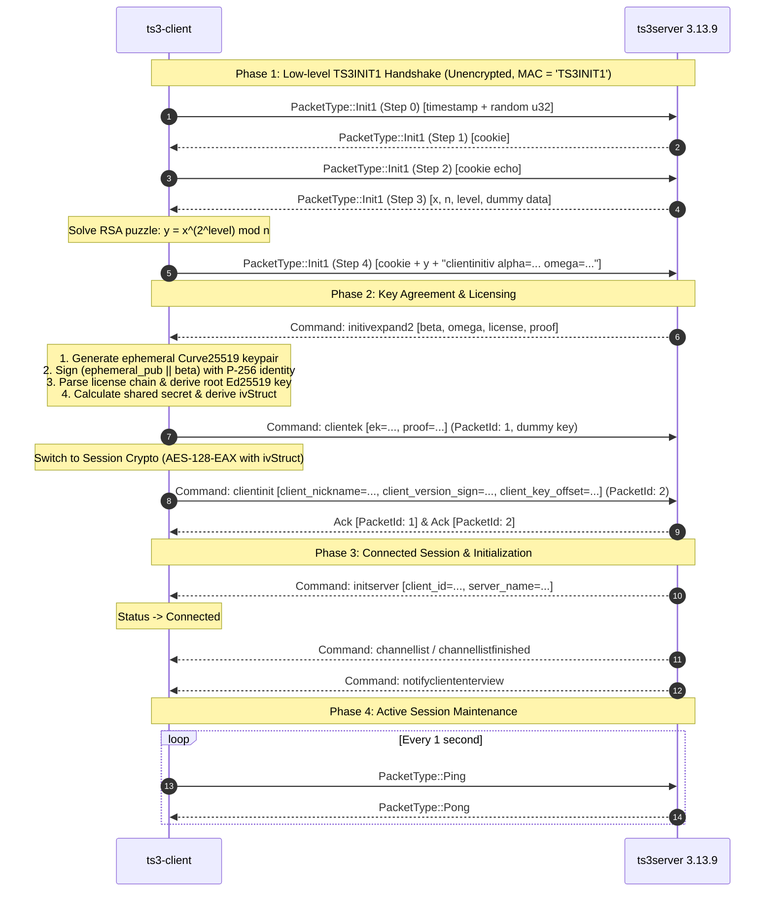

# TeamSpeak 3 Minimal Native Rust Client — Architecture & Implementation Plan

## 1. Executive Summary & Goals

This document specifies the architectural blueprint and milestone roadmap for implementing a native, minimal, memory-safe TeamSpeak 3 client in Rust (`ts3-rust`), targeting full compatibility with official **TeamSpeak 3 Server 3.13.9**.

The design references:
- **TSLib (TS3AudioBot)**: Reverse-engineered C# reference implementation located at `D:\Dev\TS3AudioBot\mx\TSLib\` (specifically `Full\Packet.cs`, `Full\PacketHandler.cs`, `Full\TsCrypt.cs`, `Full\QuickerLz.cs`, `Full\GenerationWindow.cs`, `Full\TsFullClient.cs`, `Full\License.cs`, `Full\IdentityData.cs`, and `Commands\TsString.cs`).
- **ReSpeak / tsproto / tsclientlib**: Open-source Rust TS3 protocol experiments (`tsproto`, `tsproto-packets`, `tsclientlib`), cited as architecture design references without verbatim code copying.
- **ts3server 3.13.9 binary analysis**: Executable strings and behavior verified against `D:\Dev\ts3-rust\.scratch\teamspeak3-server_linux_amd64\ts3server`.

The implementation adheres to a lean, layered workspace structure without premature abstraction, focusing on establishing a reliable connection, robust cryptography, command processing, and an interactive command-line interface.

---

## 2. Cargo Workspace Architecture

The project is structured as a single Cargo workspace containing three crates:
1. `ts3-proto`: Low-level protocol framing, packet serialization, QuickLZ decompression, command text escaping, and all cryptographic routines.
2. `ts3-client`: Network transport, connection state machine, reliability window, retransmission queue, and asynchronous command/notification dispatch.
3. `ts3-cli`: Minimal end-user interactive CLI binary for connecting, setting nicknames, querying channels, sending chat messages, and disconnecting.

### 2.1 Workspace Layout

```
ts3-rust/
├── Cargo.toml                   # Workspace manifest
├── crates/
│   ├── proto/                   # ts3-proto crate
│   │   ├── Cargo.toml
│   │   └── src/
│   │       ├── lib.rs
│   │       ├── packet/          # Header, flags, direction (C2S / S2C), framing
│   │       │   ├── mod.rs
│   │       │   ├── header.rs
│   │       │   └── types.rs
│   │       ├── crypto/          # EAX, ECDH P-256, Ed25519, hashcash, puzzle
│   │       │   ├── mod.rs
│   │       │   ├── eax.rs
│   │       │   ├── identity.rs
│   │       │   ├── license.rs
│   │       │   └── puzzle.rs
│   │       ├── quicklz/         # QuickLZ Level 1 decompressor & compressor
│   │       │   └── mod.rs
│   │       └── command/         # TS3 text command escaping, AST, parser
│   │           ├── mod.rs
│   │           ├── escape.rs
│   │           └── model.rs
│   ├── client/                  # ts3-client crate
│   │   ├── Cargo.toml
│   │   └── src/
│   │       ├── lib.rs
│   │       ├── state.rs         # Client state machine (Disconnected -> Connected)
│   │       ├── transport/       # UDP socket runner, keepalive, ping/pong
│   │       │   ├── mod.rs
│   │       │   └── socket.rs
│   │       ├── reliability/     # Ring queue, GenerationWindow, RTT / RTO resend
│   │       │   ├── mod.rs
│   │       │   ├── window.rs
│   │       │   ├── rtt.rs
│   │       │   └── queue.rs
│   │       ├── handshake.rs     # Init1 steps 0..4, clientinitiv, clientek, clientinit
│   │       └── event.rs         # Event channel and notification receiver
│   └── cli/                     # ts3-cli binary
│       ├── Cargo.toml
│       └── src/
│           ├── main.rs
│           └── repl.rs
└── docs/
    └── re/
        └── 06-rust-plan.md
```

### 2.2 Root Workspace `Cargo.toml`

```toml
[workspace]
resolver = "2"
members = [
    "crates/proto",
    "crates/client",
    "crates/cli",
]

[workspace.package]
version = "0.1.0"
edition = "2021"
rust-version = "1.80"
license = "MIT OR Apache-2.0"
authors = ["ts3-rust developers"]
```

---

## 3. Crate Dependency Matrix & Exact Versions

All crate dependencies are pinned to modern, production-grade versions from crates.io.

| Crate | Version | Workspace Crate | Purpose & Justification |
| :--- | :--- | :--- | :--- |
| `tokio` | `1.43` | `client`, `cli` | Async runtime, UDP socket (`tokio::net::UdpSocket`), timers, cancellation tokens. Features: `["net", "time", "sync", "rt-multi-thread", "macros"]`. |
| `aes` | `0.8.4` | `proto` | Core AES-128 block cipher implementation required by EAX mode (`TSLib/Full/TsCrypt.cs:42`). |
| `eax` | `0.5` | `proto` | EAX AEAD mode parameterized with `aes::Aes128` and an 8-byte MAC tag (`typenum::U8`), matching TS3's 64-bit MAC (`TSLib/Full/TsCrypt.cs:44`). |
| `p256` | `0.13.2` | `proto` | NIST P-256 (secp256r1) elliptic curve. Used for client identity, public key export, ECDH shared secret generation, and ECDSA signature creation (`TSLib/Full/TsCrypt.cs:185-207, 753-769`). |
| `curve25519-dalek` | `4.1.3` | `proto` | Montgomery/Edwards curve operations for temporary key exchange (`scalarmult`) in `initivexpand2` (`TSLib/Full/TsCrypt.cs:347-360`). |
| `ed25519-dalek` | `2.1.1` | `proto` | Ed25519 verification and key derivation for TS3 version signing and license chains (`TSLib/Full/TsCrypt.cs:771-780`, `TSLib/Full/License.cs:148-164`). |
| `sha1` | `0.10.6` | `proto` | SHA-1 hashing for client UID derivation `base64(sha1(pubkey))`, hashcash security level brute-forcing, password hashing, and fake signatures (`TSLib/Full/TsCrypt.cs:196-201, 727, 745-751, 862-877`). |
| `sha2` | `0.10.8` | `proto` | SHA-256 for per-packet key/nonce derivation from `ivStruct` (`TSLib/Full/TsCrypt.cs:684`), SHA-512 for license blocks (`TSLib/Full/License.cs:126`). |
| `num-bigint` | `0.4.6` | `proto` | Arbitrary precision arithmetic for solving the server RSA handshake puzzle: $y = x^{2^{\text{level}}} \pmod n$ (`TSLib/Full/TsCrypt.cs:495-504`). |
| `num-traits` | `0.2.19` | `proto` | Big integer traits: `One`, `Zero`, `ToPrimitive`. |
| `base64` | `0.22.1` | `proto` | Base64 encoding/decoding engine (`base64::engine::general_purpose::STANDARD`). |
| `audiopus` | `0.1.1` | `client` | Opus audio decoder/encoder bindings for voice payload handling (48 kHz, 20ms frames, Opus Voice codec ID 4) (`TSLib/Audio/`, `TSLib/Full/TsEnums.cs`). |
| `bytes` | `1.10.0` | `proto`, `client` | Zero-allocation byte buffer slices (`Bytes`, `BytesMut`). |
| `byteorder` | `1.5.0` | `proto` | Big-endian/Little-endian integer reading/writing (`NetworkEndian`). |
| `thiserror` | `2.0.11` | `proto`, `client` | Ergonomic custom error type derivations. |
| `anyhow` | `1.0.95` | `cli` | Clean error propagation for top-level CLI commands. |
| `clap` | `4.5.31` | `cli` | CLI argument parsing with `derive` macros. |
| `tracing` | `0.1.41` | `proto`, `client`, `cli` | Structured asynchronous logging and diagnostics. |
| `tracing-subscriber` | `0.3.19` | `cli` | Console logging subscriber with `EnvFilter`. |
| `rand` | `0.8.5` | `proto`, `client` | Cryptographic random number generation (`rand::rngs::OsRng`). |

---

## 4. Module Interfaces & Concrete Rust Type Signatures

The interfaces are directly modeled from `D:\Dev\TS3AudioBot\mx\TSLib\Full\`.

### 4.1 Packet Framing (`ts3-proto::packet`)

*Reference: `TSLib/Full/Packet.cs:18-195`, `TSLib/Full/PacketType.cs:14-36`.*

```rust
use std::marker::PhantomData;
use bytes::{Bytes, BytesMut};

pub const MAC_LEN: usize = 8;
pub const MAX_PACKET_SIZE: usize = 500;
pub const DUMMY_KEY_NONCE: &[u8; 32] = b"c:\\windows\\system\\firewall32.cpl";
pub const TS3_INIT_MAC: &[u8; 8] = b"TS3INIT1";

#[repr(u8)]
#[derive(Debug, Clone, Copy, PartialEq, Eq, Hash)]
pub enum PacketType {
    Voice = 0x0,
    VoiceWhisper = 0x1,
    Command = 0x2,
    CommandLow = 0x3,
    Ping = 0x4,
    Pong = 0x5,
    Ack = 0x6,
    AckLow = 0x7,
    Init1 = 0x8,
}

bitflags::bitflags! {
    #[derive(Debug, Clone, Copy, PartialEq, Eq, Hash)]
    pub struct PacketFlags: u8 {
        const NONE         = 0x00;
        const FRAGMENTED   = 0x10;
        const NEW_PROTOCOL = 0x20;
        const COMPRESSED   = 0x40;
        const UNENCRYPTED  = 0x80;
    }
}

pub trait Direction: 'static + Send + Sync {
    const FROM_SERVER: bool;
    const HEADER_LEN: usize;
}

#[derive(Debug, Clone, Copy, PartialEq, Eq)]
pub struct C2S;
impl Direction for C2S {
    const FROM_SERVER: bool = false;
    const HEADER_LEN: usize = 5; // packet_id (2) + client_id (2) + type_flags (1)
}

#[derive(Debug, Clone, Copy, PartialEq, Eq)]
pub struct S2C;
impl Direction for S2C {
    const FROM_SERVER: bool = true;
    const HEADER_LEN: usize = 3; // packet_id (2) + type_flags (1)
}

#[derive(Debug, Clone, PartialEq, Eq)]
pub struct Packet<D: Direction> {
    pub mac: [u8; MAC_LEN],
    pub packet_id: u16,
    pub client_id: u16, // only used if D == C2S (0 for unassigned)
    pub packet_type: PacketType,
    pub flags: PacketFlags,
    pub generation_id: u32,
    pub data: Bytes,
    _dir: PhantomData<D>,
}

impl<D: Direction> Packet<D> {
    pub fn new(packet_type: PacketType, flags: PacketFlags, packet_id: u16, generation_id: u32, data: Bytes) -> Self;
    pub fn encode_header(&self, buf: &mut [u8]);
    pub fn decode(raw: &[u8]) -> Result<Self, PacketError>;
    pub fn serialize_raw(&self) -> Bytes;
}
```

### 4.2 QuickLZ Level-1 Compression (`ts3-proto::quicklz`)

*Reference: `TSLib/Full/QuickerLz.cs:19-250`.*

```rust
pub struct QuickLz;

#[derive(Debug, thiserror::Error)]
pub enum QuickLzError {
    #[error("Data too short to read header")]
    TruncatedHeader,
    #[error("Decompressed size exceeds limit: {0} bytes")]
    DecompressedLimitExceeded(usize),
    #[error("Corrupted QuickLZ stream: out-of-bounds match reference")]
    CorruptedStream,
    #[error("Unsupported QuickLZ configuration: only Level 1 supported")]
    UnsupportedLevel,
}

impl QuickLz {
    pub const MAX_DECOMPRESSED_SIZE: usize = 1024 * 1024; // TSLib/Full/PacketHandler.cs:798

    pub fn get_decompressed_size(data: &[u8]) -> Result<usize, QuickLzError>;
    pub fn decompress(data: &[u8], max_size: usize) -> Result<Vec<u8>, QuickLzError>;
    pub fn compress(data: &[u8]) -> Vec<u8>;
}
```

### 4.3 Cryptography & Handshake State (`ts3-proto::crypto`)

*Reference: `TSLib/Full/TsCrypt.cs:33-700`, `TSLib/Full/IdentityData.cs:19-51`, `TSLib/Full/License.cs:18-164`.*

```rust
use p256::{ecdsa::SigningKey, PublicKey as P256PublicKey};
use num_bigint::BigUint;

pub struct Identity {
    pub signing_key: SigningKey,
    pub public_key: P256PublicKey,
    pub public_key_base64: String,
    pub client_uid: String, // base64(sha1(pubkey_der))
    pub valid_key_offset: u64,
}

impl Identity {
    pub fn generate_new(target_security_level: u32) -> Self;
    pub fn from_obfuscated_string(s: &str) -> Result<Self, CryptoError>;
    pub fn export_obfuscated_string(&self) -> String;
    pub fn compute_security_level(pubkey_b64: &str, offset: u64) -> u32;
    pub fn improve_security_level(&mut self, target_level: u32);
}

pub struct RsaPuzzleSolver;
impl RsaPuzzleSolver {
    /// Solves x^(2^level) mod n
    /// Ref: TSLib/Full/TsCrypt.cs:495-504
    pub fn solve(x_bytes: &[u8], n_bytes: &[u8], level: u32) -> Result<Vec<u8>, CryptoError>;
}

pub struct LicenseChain;
impl LicenseChain {
    pub const ROOT_KEY: [u8; 32] = [
        0xcd, 0x0d, 0xe2, 0xae, 0xd4, 0x63, 0x45, 0x50,
        0x9a, 0x7e, 0x3c, 0xfd, 0x8f, 0x68, 0xb3, 0xdc,
        0x75, 0x55, 0xb2, 0x9d, 0xcc, 0xec, 0x73, 0xcd,
        0x18, 0x75, 0x0f, 0x99, 0x38, 0x12, 0x40, 0x8a,
    ]; // TSLib/Full/License.cs:20-24

    pub fn parse_and_derive_key(license_bytes: &[u8]) -> Result<[u8; 32], CryptoError>;
}

pub struct TsCrypt {
    identity: Identity,
    crypto_init_complete: bool,
    iv_struct: Option<Vec<u8>>, // 20 or 64 bytes
    fake_signature: [u8; 8],
}

impl TsCrypt {
    pub fn new(identity: Identity) -> Self;

    /// Ref: TSLib/Full/TsCrypt.cs:362-488
    pub fn process_init1_response(&mut self, data: Option<&[u8]>) -> Result<Vec<u8>, CryptoError>;

    /// Ref: TSLib/Full/TsCrypt.cs:312-360
    pub fn init_crypto2(
        &mut self,
        license: &str,
        omega: &str,
        proof: &str,
        beta: &str,
        ephemeral_privkey: &[u8; 32],
    ) -> Result<(), CryptoError>;

    /// Derives 16-byte key and 16-byte nonce for a packet
    /// Ref: TSLib/Full/TsCrypt.cs:662-700
    pub fn get_key_nonce(
        &mut self,
        from_server: bool,
        packet_id: u16,
        generation_id: u32,
        packet_type: PacketType,
        dummy_encryption: bool,
    ) -> ([u8; 16], [u8; 16]);

    /// Encrypts in-place with AES-128-EAX (8-byte tag)
    pub fn encrypt<D: Direction>(&mut self, packet: &mut Packet<D>) -> Result<(), CryptoError>;

    /// Decrypts in-place with AES-128-EAX (8-byte tag)
    pub fn decrypt<D: Direction>(&mut self, packet: &mut Packet<D>) -> Result<(), CryptoError>;
}
```

### 4.4 Command Serializer & Escaping (`ts3-proto::command`)

*Reference: `TSLib/Commands/TsString.cs:25-100`, `TSLib/Commands/TsCommand.cs:21-80`.*

```rust
use std::collections::HashMap;

pub struct TsString;
impl TsString {
    pub fn escape(input: &str) -> String;
    pub fn unescape(input: &str) -> Result<String, CommandError>;
    pub fn unescape_bytes(input: &[u8]) -> Result<Vec<u8>, CommandError>;
}

#[derive(Debug, Clone, PartialEq, Eq)]
pub struct Command {
    pub name: String,
    pub parameters: Vec<HashMap<String, String>>, // pipe-separated parameter maps
    pub options: Vec<String>,
}

impl Command {
    pub fn new(name: impl Into<String>) -> Self;
    pub fn with_param(mut self, key: &str, value: &str) -> Self;
    pub fn parse(raw: &str) -> Result<Self, CommandError>;
    pub fn serialize(&self) -> String;
}
```

### 4.5 Reliability & Retransmission Layer (`ts3-client::reliability`)

*Reference: `TSLib/Full/GenerationWindow.cs:14-98`, `TSLib/Full/PacketHandler.cs:28-83, 784-800`.*

```rust
use std::time::{Duration, Instant};
use std::collections::HashMap;

pub const PACKET_TIMEOUT: Duration = Duration::from_secs(30);
pub const MAX_RETRY_INTERVAL: Duration = Duration::from_millis(1000);
pub const PING_INTERVAL: Duration = Duration::from_secs(1);
pub const CLOCK_RESOLUTION: Duration = Duration::from_millis(100);
pub const ALPHA_SMOOTH: f32 = 0.125;
pub const BETA_SMOOTH: f32 = 0.25;

pub struct GenerationWindow {
    mod_val: u32,       // 65536 for packet_id
    receive_window: u32,// 32768
    base_offset: u32,
    generation: u32,
}

impl GenerationWindow {
    pub fn new(mod_val: u32) -> Self;
    pub fn is_in_window(&self, val: u16) -> bool;
    pub fn get_generation(&self, val: u16) -> u32;
    pub fn advance_to_excluded(&mut self, val: u16);
    pub fn reset(&mut self);
}

pub struct RttEstimator {
    srtt: Duration,
    rttvar: Duration,
    rto: Duration,
}

impl RttEstimator {
    pub fn new() -> Self;
    pub fn update(&mut self, sample: Duration);
    pub fn current_rto(&self) -> Duration;
}

pub struct ResendPacket {
    pub raw: Bytes,
    pub packet_id: u16,
    pub first_send: Instant,
    pub last_send: Instant,
}
```

### 4.6 Client Connection State Machine (`ts3-client::state`)

*Reference: `TSLib/Full/TsFullClient.cs:48-66, 171-209, 259-316`.*

```rust
#[derive(Debug, Clone, Copy, PartialEq, Eq)]
pub enum TsClientStatus {
    Disconnected,
    Connecting,
    Connected,
    Disconnecting,
}

pub struct TsClientConfig {
    pub address: String, // "127.0.0.1:9987"
    pub nickname: String,
    pub server_password: Option<String>,
    pub default_channel: Option<String>,
    pub default_channel_password: Option<String>,
    pub identity: Identity,
    pub version_sign: TsVersionSigned,
}

pub enum ClientEvent {
    Connected { client_id: u16 },
    Disconnected { reason: String },
    ChannelListEntry { channel_id: u64, name: String, order: u64 },
    ChannelListFinished,
    ClientEnterView { client_id: u16, channel_id: u64, nickname: String },
    ClientLeftView { client_id: u16, reason_msg: String },
    TextMessageReceived { sender_id: u16, target_mode: u8, message: String },
}

pub struct TsClient {
    status: TsClientStatus,
    config: TsClientConfig,
    crypt: TsCrypt,
    // internal channels and async handles
}

impl TsClient {
    pub async fn connect(config: TsClientConfig) -> Result<(Self, tokio::sync::mpsc::Receiver<ClientEvent>), ClientError>;
    pub async fn send_text_message(&self, target_mode: u8, target_id: u64, message: &str) -> Result<(), ClientError>;
    pub async fn set_nickname(&self, nickname: &str) -> Result<(), ClientError>;
    pub async fn disconnect(&mut self, reason: &str) -> Result<(), ClientError>;
}
```

---

## 5. Connection & Handshake Execution Flow



---

## 6. Implementation Milestones & Acceptance Test Suite

The milestones are sequenced to validate each layer in isolation before proceeding to integrated network operations against `ts3server 3.13.9`.

### Milestone 1: Packet Framing, QuickLZ & Command AST
- **Deliverables**:
  - `ts3-proto::packet`: Bitflags, `Packet<C2S>` and `Packet<S2C>` header encode/decode, endian conversion.
  - `ts3-proto::quicklz`: Level-1 QuickLZ decompressor matching `TSLib/Full/QuickerLz.cs`.
  - `ts3-proto::command`: Escaper, unescaper, and parameter tokenizer.
- **Acceptance Tests**:
  - `test_packet_header_c2s_roundtrip`: Serialize and deserialize C2S header with flags `Fragmented | Compressed`.
  - `test_quicklz_level1_vector`: Decompress test payload and verify match with known uncompressed buffer.
  - `test_command_escaping_all_characters`: Test escaping and unescaping of `\s`, `\p`, `\/`, `\\`, `\n`, `\r`, `\t`, `\v`, `\f`.
  - `test_command_parse_initivexpand2`: Parse full `initivexpand2` command string into key-value map.

### Milestone 2: Cryptographic Primitives & Identity Subsystem
- **Deliverables**:
  - `ts3-proto::crypto::identity`: P-256 key import/export, base64 UID computation, hashcash zero-bit count.
  - `ts3-proto::crypto::puzzle`: `BigUint` modulo power puzzle solver.
  - `ts3-proto::crypto::license`: License chain block parser and Ed25519 point derivation.
  - `ts3-proto::crypto::eax`: AES-128-EAX encryption/decryption with 8-byte tag.
- **Acceptance Tests**:
  - `test_identity_hashcash_verification`: Generate identity with security level 8; verify that `compute_security_level` returns $\ge 8$.
  - `test_rsa_puzzle_solver_vector`: Verify puzzle solution against known TS3 server challenge vector:
    $$x = \text{0x02}, \quad n = \text{0x0f}, \quad \text{level} = 3 \implies 2^{(2^3)} \pmod{15} = 2^8 \pmod{15} = 256 \pmod{15} = 1.$$
  - `test_eax_dummy_key_roundtrip`: Encrypt and decrypt packet payload using dummy key `"c:\\windows\\system\\firewall32.cpl"` with 8-byte MAC.
  - `test_per_packet_nonce_xor`: Validate that `key[0..2]` is properly XOR'd with `packet_id`.

### Milestone 3: Transport & Reliability Engine
- **Deliverables**:
  - `ts3-client::reliability`: `GenerationWindow` generation wraparound tracking, `RttEstimator`, `RingQueue` deduplication.
  - Outgoing packet retry scheduler with exponential backoff and timeout detection (30s).
- **Acceptance Tests**:
  - `test_generation_window_wraparound`: Feed IDs `65534`, `65535`, `0`, `1`; verify generation increments from 0 to 1 at transition.
  - `test_rtt_estimator_backoff`: Validate SRTT and RTO smoothing calculations match RFC 6298 / TSLib smoothing factors ($\alpha = 0.125, \beta = 0.25$).
  - `test_simulated_loss_retransmission`: Inject UDP packet loss in local mock; verify unacked packet is retransmitted within RTO.

### Milestone 4: Handshake Integration against ts3server 3.13.9
- **Deliverables**:
  - `ts3-client::handshake`: Complete state progression from `Init1(0)` to `clientinit`.
- **Acceptance Tests (Live Local Server `ts3server 3.13.9`)**:
  - `test_live_handshake_step0_to_step4`: Execute Init1 steps 0 through 4 against `127.0.0.1:9987`; verify server returns step 1, step 3, and accepts step 4.
  - `test_live_initivexpand2_derivation`: Receive `initivexpand2`, calculate shared secret, send `clientek`, switch session cipher, and receive server Acks.
  - `test_live_initserver_transition`: Send `clientinit`, receive `initserver`, and confirm assigned `client_id` $> 0$.

### Milestone 5: Connected Session & Command Dispatch
- **Deliverables**:
  - Active session handling: Keepalive Ping/Pong loop every 1 second.
  - Command execution: `channellist`, `clientupdate client_nickname=...`, `sendtextmessage targetmode=2 msg=...`.
  - Graceful disconnection: `clientdisconnect reasonmsg="bye"`.
- **Acceptance Tests (Live Local Server `ts3server 3.13.9`)**:
  - `test_live_channel_listing`: Verify client receives default channel ("Default Channel", ID 1) via `channellist`.
  - `test_live_ping_pong_stability`: Maintain live connection for 30 seconds without timeout disconnect.
  - `test_live_chat_echo`: Send text message to channel and verify receipt via `notifytextmessage`.
  - `test_live_graceful_disconnect`: Disconnect cleanly and verify server logs client exit reason without timeout error.

### Milestone 6: `ts3-cli` Interactive Binary
- **Deliverables**:
  - Asynchronous REPL running on Tokio with interactive commands:
    - `connect <addr> [nick]`
    - `nick <new_nick>`
    - `channels`
    - `msg <text>`
    - `disconnect`
- **Acceptance Tests**:
  - Automated integration test executing CLI commands via stdin/stdout pipes against live `ts3server 3.13.9`.

---

## 7. Protocol Risks & Mitigations

| Risk | Impact | Root Cause & Mechanism | Mitigation Strategy |
| :--- | :--- | :--- | :--- |
| **EAX Tag Size Mismatch** | High (Packets rejected) | RustCrypto `eax` crate defaults to 16-byte authentication tags (`typenum::U16`), whereas TeamSpeak 3 uses 8-byte tags (`typenum::U8`, `TSLib/Full/TsCrypt.cs:44`). | Parameterize the cipher type as `Eax<Aes128, typenum::U8>` and assert slice lengths explicitly in unit tests. |
| **Ack Decryption Race Condition** | High (Connection stalls during handshake) | `clientek` is sent with the dummy key, while subsequent `clientinit` is sent with the session key. Acks from the server may arrive out of order (`TSLib/Full/TsCrypt.cs:597-614`). | If decrypting an Ack packet with ID $\le 2$ fails with the session key, retry decryption using the dummy key before dropping the packet. |
| **Little-Endian Bit Order in Hashcash** | Medium (Invalid identity offset) | TS3 hashcash leading zero-bit counter iterates bits $0 \dots 7$ from least-significant to most-significant within each byte (`TSLib/Full/TsCrypt.cs:888-891`). | Implement `get_leading_zero_bits` matching the exact bitwise check `(byte & (1 << bit)) == 0` rather than standard big-endian `leading_zeros()`. |
| **Ed25519 Scalar Clamping in License Chains** | High (Broken key derivation) | TeamSpeak clamps intermediate hash bytes (`Hash[31] &= 0x7F`, scalar clamping) during license key derivation (`TSLib/Full/License.cs:149`, `TSLib/Full/TsCrypt.cs:351`). | Use low-level Edwards curve scalar multiplication from `curve25519-dalek` with explicit clamping (`clamp_integer`). |
| **Packet ID 0 Skip in Command Counters** | Medium (Protocol desync) | Legacy TS3 clients sent `clientinitiv` as command packet ID 0. Modern servers omit this, but still expect the first client command (`clientek`) to use packet ID 1 (`TSLib/Full/PacketHandler.cs:94`). | Increment the outgoing Command packet counter once immediately upon socket initialization. |
| **QuickLZ Compression Edge Cases** | Medium (Memory corruption / panic) | Server packets exceeding MTU (500 bytes) are compressed with QuickLZ Level 1 (`TSLib/Full/QuickerLz.cs:175-235`). Malformed packets could cause out-of-bounds reads. | Strictly enforce safe bounds checking in the decompressor, returning `QuickLzError::CorruptedStream` rather than unsafe indexing. |
